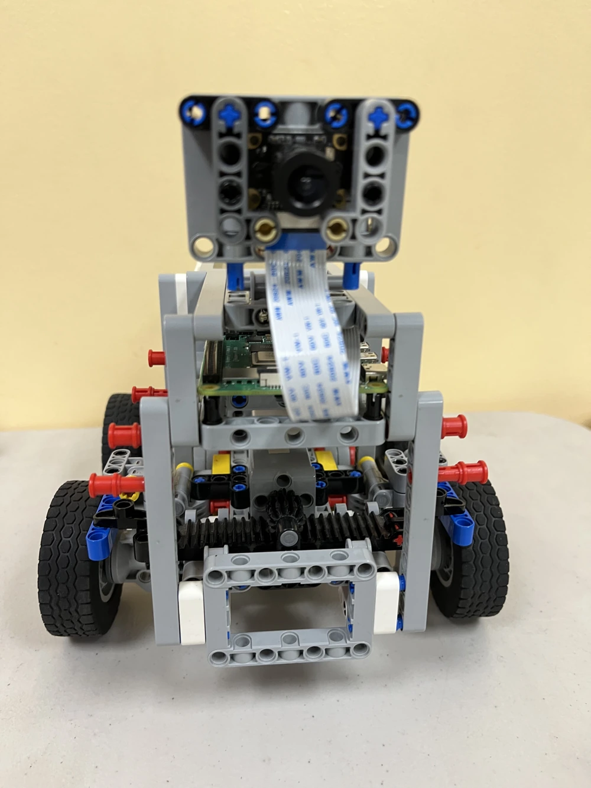
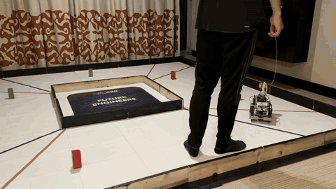
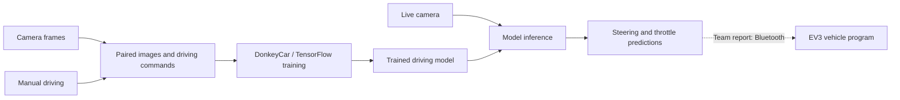

# Autonomous mini-vehicle

An early autonomous-driving team project from **WRO Future Engineers 2023**, using a Raspberry Pi camera pipeline and an EV3 vehicle. I worked on driving-model training and vehicle integration.

[Project overview](https://evangirardsun.com/?project=mini-vehicle) · [Full-resolution driving clip](https://evangirardsun.com/assets/mini-driving-v5.mp4)

## Approach

The team used behavioral cloning: record camera images paired with manual driving commands, train a model, and use its predictions to guide the vehicle. DonkeyCar supplied the software framework and training pipeline, with TensorFlow for the model. The project report describes the Raspberry Pi sending commands to an EV3 vehicle over Bluetooth.

The archived camera configuration is **160 × 120 pixels** with a **20 Hz vehicle-loop setting**. Those are configuration values, not measured throughput or driving-performance results.

## Explore the archive

| Material | Location |
|---|---|
| Python source and EV3 project | [src/](FEV-WRO%202023-Future%20Engineers/src/) |
| Original team report | [Project README](FEV-WRO%202023-Future%20Engineers/README.md) |
| Engineering journal | [Engineering Journal/](FEV-WRO%202023-Future%20Engineers/Engineering%20Journal/) |
| Original diagrams | [schemes/](FEV-WRO%202023-Future%20Engineers/schemes/) |
| Vehicle photographs | [v-photos/](FEV-WRO%202023-Future%20Engineers/v-photos/) |
| Original videos | [videos/](FEV-WRO%202023-Future%20Engineers/videos/) |
| Source review and limitations | [docs/archive-scope.md](docs/archive-scope.md) |

## Source status

The original 2023 files and commit history are retained. The Python source includes DonkeyCar driving, calibration, and training scripts. The archive does not contain a trained model or a complete training dataset.

The saved DonkeyCar configuration selects a PWM steering/throttle output. That differs from the EV3/Bluetooth arrangement described in the team report; a matching Python bridge has not been identified in this archive. The EV3 program is present as `FEV001.ev3`. Treat the files as a historical project archive rather than a complete installation for a new vehicle.

The Python files pass a syntax check. Their hardware interfaces and the original training environment have not been revalidated.

## Credits

Team FEV USA: **Fengmo Guo, Evan Girard-Sun, and Vinaya Ayinampudi**. Coach: **Fei Guo**.

The software is built on [DonkeyCar](https://github.com/autorope/donkeycar) and [TensorFlow](https://www.tensorflow.org/). DonkeyCar provides the vehicle framework and training implementation. The original team report remains available alongside this shorter project overview.

[Evan Girard-Sun](https://evangirardsun.com/)
